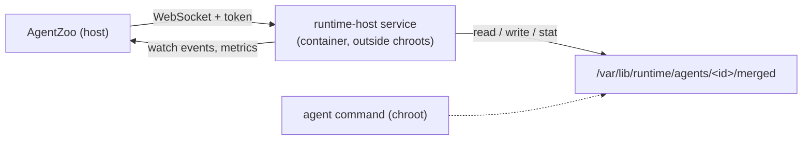

# Runtime host protocol (proposed)

Status: implemented and wired into the runtime image: handshake, ping,
`fs.stat`, `fs.read`, `fs.list`, `fs.search`, `fs.write`, `fs.remove`, and
`fs.watch`. `read_file`, `list_directory`, `search_files`, `write_file`, and
`edit_file` use the host when the backend provides it (`RuntimeEnv.files`);
`apply_patch` keeps its diff logic in TypeScript and commits through host writes
and removals. Every migrated tool keeps the `exec` path as the fallback. Shell
and terminals still run through `exec`.

The runtime container currently carries most tool logic as shell strings passed
to `bash -c`. Quoting, exit-code tables, `PIPESTATUS`, `sed`/`awk` behaviour,
line-ending handling, and path checks all live in that boundary. This document
proposes a resident process in the same container, outside every agent root,
that tools address over WebSocket instead.

## Confirmed decisions

- The service is built with `deno compile` and run with `-A`. Permission flags
  would only re-state a boundary we already enforce structurally: the binary
  lives outside every agent root and agents cannot see or modify it.
- The container-side port is fixed; the host-side port is assigned by Docker and
  read from the container inspect. A fixed host port would collide with
  unrelated services and buys nothing.
- `fs.watch` watches the merged roots, so events cover everything an agent can
  observe. Watching overlay upper dirs is cheaper but changes the meaning of a
  path in events.
- Metrics start with the basics: request counts, latency, queue depth, and
  subscription overflow, written to the runtime log. The dashboard shows only
  what a row can display today; the schema is not designed around a future
  redesign.

## Goals

- One place for byte-exact file IO, line/byte reads, containment checks, and
  size caps.
- No shell interpolation between AgentZoo and the runtime.
- Streaming: file watches, activity, and metrics are push channels, not polling.
- The process is invisible to agents and cannot be modified by them.

## Non-goals (at first)

- Replacing `apply_patch`'s diff algorithm. jsdiff stays in AgentZoo; the host
  only reads and writes exact bytes.
- Replacing interactive terminals or background sessions. They rely on the
  agent's mount and PID namespaces and move later, if at all.
- Defining a public API. This is an internal contract between AgentZoo and the
  runtime image, versioned together.

## Process model



- One process per runtime container, started by the entrypoint in a fixed 1 s
  restart loop.
- Runs as container root, outside the agent roots, with no agent-writable binary
  or configuration in its path.
- Agents cannot see it: it lives in the container's PID namespace, not theirs.
- The container publishes `127.0.0.1::8787`; AgentZoo reads the assigned host
  port with `docker port`.
- Protocol version is fixed at connect time; a mismatch is refused.

## Transport and framing

- WebSocket over the published loopback port.
- Text frames carry JSON control messages.
- Binary frames carry payloads: `[uint32 sequence, big-endian][bytes]`.
  Responses use the server's sequence in `seq`; requests name theirs with
  `payloadSeq` and send the binary frame first, so concurrent transfers are
  correlated without base64.
- One connection per active agent environment, multiplexed by request id. (A
  per-container connection is possible later.)

### Handshake

```jsonc
// client -> server
{"op":"hello","protocol":1,"token":"<per-container random>"}
// server -> client
{"ok":true,"result":{"protocol":1,"helperVersion":"0.1.0"}}
```

The token is generated per container, passed only to the service and to
AgentZoo, and never placed in an agent-visible path or argv.

### Requests

```jsonc
{"id":"42","op":"fs.read","agent":"alice","params":{"path":"/root/x.py","unit":"lines","startLine":40,"lineLimit":200}}
{"id":"42","ok":true,"result":{"unit":"lines","startLine":40,"linesReturned":200,"totalLines":312,"nextLine":240,"truncated":true}}
{"id":"42","ok":false,"error":{"code":"path_escape","message":"/root/x.py resolves outside the agent root"}}
```

- Cancellation is planned; today a client-side timeout is the only bound.
- The client does not retry a request after it is sent; it drops the connection
  and reconnects on the next call. Retrying an append after an unknown outcome
  would duplicate content.

## File operations

Paths are absolute paths inside the named agent's root. The service resolves
them beneath `/var/lib/runtime/agents/<agent>/merged` and refuses anything that
escapes, including symlinks and `..`.

### `fs.stat`

```jsonc
{ "agent": "alice", "path": "/root/x.py" }
// -> {"type":"file","sizeBytes":4210,"mode":420,"mtimeMs":...,"symlink":false}
```

`type` describes the referent (`file`, `directory`, or `other`), because the
open follows links inside the root. The separate `symlink` flag reports whether
the requested path traversed a symbolic link; `type: "symlink"` is therefore not
produced.

### `fs.read`

Mirrors the tool's dual-unit contract, so the helper owns the units and the tool
only chooses defaults.

```jsonc
{"agent":"alice","path":"/root/x.py","unit":"bytes","offset":0,"limit":65536}
{"agent":"alice","path":"/root/x.py","unit":"lines","startLine":40,"lineLimit":200}
```

- `bytes`: 0-based `offset`, `limit` bytes. Result: `offset`, `bytesRead`,
  `sizeBytes`, `nextByteOffset`, `truncated`.
- `lines`: 1-based `startLine`, `lineLimit` lines. Result: `startLine`,
  `linesReturned`, `totalLines`, `nextLine`, `truncated`.
- Content is returned as a binary frame; metadata in the JSON result.
- Line reads never split a UTF-8 character. Byte reads may, and report
  `invalid_utf8` with the offending range.
- Line reads are capped by the 1 MiB per-response limit as well as by lines; the
  cut is made at the last complete line and reflected in `truncated`/`nextLine`.
- Binary content (NUL bytes) is reported as `binary`, never decoded.
- Per-response cap: 1 MiB. Byte windows larger than the cap are clamped to it.

### `fs.list`

```jsonc
{ "agent": "alice", "path": "/root", "limit": 500 }
// -> {"path":"/root","entries":[{"name":".bashrc","type":"file","sizeBytes":3779}],"truncated":false}
```

Immediate entries only; no recursion. Entry types come from `lstat`, so a
symlink reports as `symlink` and its target size is not substituted.

### `fs.search`

```jsonc
{
  "agent": "alice",
  "path": "/shared/project",
  "kind": "text",
  "text": "needle",
  "name": "*.py",
  "maxResults": 50
}
```

Recursive. `kind` is `name` or `text`. Text search reads regular files and
symlinks whose referent is a regular file; FIFOs, devices, and broken links are
skipped. Directory links are skipped as well, so the walk cannot cycle. Results
are bounded and report `truncated`. Paths in results are relative to `path`, or
absolute when `path` is absolute.

### `fs.write`

The target's parent is opened through the contained open; the final component is
never followed through a symlink. Content is written to a temporary file in the
same directory and committed with `link(2)` (create, failing if the target
exists) or `rename(2)` (overwrite/append), so a failed write never leaves a
truncated file. Overwrites and appends preserve the existing mode and owner.

```jsonc
{
  "agent": "alice",
  "op": "fs.write",
  "params": { "path": "/root/x.py", "mode": "create" }
}
// binary payload: file bytes
// -> {"path":"/root/x.py","mode":"create","created":true,"sizeBytes":4210}
```

`mode` is `create`, `overwrite`, or `append`. A symlink target, a non-regular
file, a missing parent, and an existing create target are refused with
`symlink`, `not_a_file`, `not_found`, and `conflict` respectively.

### `fs.remove`

```jsonc
{ "agent": "alice", "params": { "path": "/root/old.py" } }
// -> {"path":"/root/old.py","removed":true}
```

Unlinks the entry through the contained parent directory, so a symlink is
removed rather than its referent. A missing path reports `removed: false`
(idempotent); directories are refused with `not_a_file`.

## Write transactions (planned)

The transaction stays in AgentZoo; the service provides exact primitives.

- `fs.writeTemp` `{agent, path, expect:"missing"|"file", mode?}` with the new
  content as a binary frame. Creates a temporary file beside the target,
  preserving the existing mode and owner when `expect` is `file`. Returns a
  temporary id, not a path.
- `fs.commit` `{agent, ops:[{tempId, path} | {remove, path}]}` renames and
  removes in one `set -e`-equivalent sequence. On failure, the service reports
  which entries were applied so AgentZoo can restore from the bytes it read
  before staging.
- `fs.remove` `{agent, path}` for deletions outside a transaction.

## Subscriptions

```jsonc
{"op":"subscribe","sub":"7","channel":"fs.watch","agent":"alice","params":{"path":"/root","depth":2,"debounceMs":100}}
{"sub":"7","event":{"kind":"changed","path":"/root/x.py"}}
{"op":"unsubscribe","sub":"7"}
```

Initial channel: `fs.watch`, coalesced change/create/remove events under a path.
`runtime.metrics` and `agent.activity` are planned, not implemented.

Rules:

- Watches are coalesced per path (default 100 ms) and depth-capped. Inotify
  limits are per container; the service reports `watch_limit` instead of
  silently dropping a subscription.
- The pending path buffer is capped at 4096 entries. Overflow drops paths and
  the next event carries `dropped: N`.
- Subscriptions do not survive a reconnect; the client resubscribes and accepts
  a gap.

## Errors

Helper errors are transport-level; tools translate them into their existing
`ToolFeedback` text.

| Code                             | Meaning                                    |
| -------------------------------- | ------------------------------------------ |
| `invalid_request`                | malformed op or params                     |
| `unauthorized`                   | missing/incorrect token                    |
| `unknown_agent`                  | agent root does not exist                  |
| `path_escape`                    | resolved path leaves the agent root        |
| `not_found`                      | path does not exist                        |
| `not_a_file` / `not_a_directory` | wrong type                                 |
| `binary`                         | content is not text                        |
| `invalid_utf8`                   | byte range splits a character              |
| `too_large`                      | per-request or per-file cap exceeded       |
| `range`                          | start/limit outside the file               |
| `conflict`                       | unexpected file state for a write          |
| `timeout` / `cancelled`          | operation ended early                      |
| `internal`                       | unexpected failure; details in server logs |

## Container wiring (implemented)

- `deno task runtime-host:build` cross-compiles the service to
  `packages/core/runtime/agentzoo-runtime-host`; `buildRuntimeImage` compiles it
  before every image build, so tests and `docker:build` stay in sync.
- The Containerfile copies the binary to `/usr/local/bin` **after** the rootfs
  template is created, so no agent chroot contains it.
- The entrypoint creates a per-container token at
  `/var/lib/runtime/runtime-host.token` (mode 0600, in the data volume, so it
  survives restarts), exports it, and starts the service in a restart loop for
  the container's main process. Logs go to `/var/lib/runtime/runtime-host.log`.
- The container publishes `127.0.0.1::8787`; AgentZoo reads the assigned host
  port and the token after start and exposes them as
  `DockerRuntimeManager.runtimeHostEndpoint()`.
- `RuntimeHostClient` in `packages/core` speaks the protocol (requests, binary
  payloads, subscriptions); `RuntimeHostFiles` maps it onto `RuntimeEnv.files`
  for the migrated read-only tools.

## Security

The service is the most privileged component in the container, so its boundary
must be explicit.

- **Token is the only gate.** The listener binds `0.0.0.0` inside the container
  (required for Docker's published port), so any container on the same bridge
  network can reach it, and agents share the container's network namespace. The
  token must therefore never appear in an agent root, argv, or environment
  visible inside a chroot. `agent` is chosen by the authenticated client; an
  agent that somehow reached the socket could otherwise name another agent's
  root.
- **Containment is structural, not textual.** The open goes through
  `openat2(RESOLVE_IN_ROOT | RESOLVE_NO_MAGICLINKS)` against the agent's merged
  root. That flag gives chroot semantics: an absolute symlink target starts at
  the agent root and `..` clamps there, so an escape is structurally impossible.
  The lexical resolver runs first only to produce model-facing errors and the
  symlink flag; the kernel makes the security decision. Prefix checks on strings
  are not sufficient: an agent controls every symlink in its tree. The runtime
  image's glibc has no `openat2` wrapper and Deno FFI has no variadic
  parameters, so the service calls `syscall(SYS_openat2, ...)` through a
  fixed-arity declaration and writes the `open_how` fields little-endian.
- **No blocking opens.** Open with `O_NONBLOCK`, `fstat`, then decide. A FIFO
  under an agent root must not be able to hang a request.
- **Per-agent quotas.** Bound concurrent ops per agent, request size, response
  size, and subscription count. One busy agent must not starve the others.
- **TOCTOU.** A check-then-open on an agent-controlled path is racy. Prefer the
  kernel primitive; if a fallback walk is used, document the residual window.

## Lifecycle and failure

- The service is a single point of failure for tools. Until parity is proven,
  AgentZoo keeps the current `chroot-exec` path as a fallback, selected by
  configuration.
- Health is a `ping` op; reconnect uses exponential backoff and re-establishes
  subscriptions.
- A crash must surface as `runtime_unavailable` with the helper's last error,
  not as a phantom successful result.
- No cache of agent roots in the first version: every request stats through the
  filesystem, so agent creation, reset, and purge need no invalidation.

## Migration

1. Define `RuntimeHostClient` in core with two implementations: the current
   `docker exec` transport and the WebSocket transport.
2. Implement read-only ops (`stat`, `read`, `list`, `search`) and `fs.watch`.
3. Move the read-only tools behind the client, keeping the exec path selectable
   until the Docker suites run green on both. Done for `read_file`,
   `list_directory`, and `search_files` via `RuntimeEnv.files`; the shell
   scripts remain the fallback.
4. Add write ops and move `edit_file`/`write_file`; keep `apply_patch` in TS.
   `write_file`, `edit_file`, and the `apply_patch` commit path are migrated.
5. Decide command execution and PTYs separately; they need namespace entry, not
   just file IO.

## Open questions

- Deno FFI exposes no `errno`, so a refused open is classified conservatively
  (missing path, or escape) instead of by errno. Confirm that is precise enough
  before write operations depend on it.
- Whether `fs.watch` uses `Deno.watchFs` per subscription or one shared watcher
  with a routing table; the latter scales better across many agents.
- The metrics shape the dashboard actually needs, so the channel is designed
  once.
- Whether `exec` runs in the container namespace and enters the agent's via
  `setns`, or keeps delegating to `runtime-host`.
